# EventPass

[](https://github.com/zakaech/EventPass/actions/workflows/ci.yml)

**Plateforme de billetterie d'événements** : les spectateurs réservent leurs places et reçoivent
des billets à QR code signé, les organisateurs publient leurs événements, suivent leurs ventes et
**scannent les billets à l'entrée avec la caméra de leur téléphone**, les administrateurs valident
les comptes organisateurs.

Projet de portfolio full-stack : React, Node.js/Express, PostgreSQL en SQL écrit à la main, Docker,
GitHub Actions. L'accent est mis sur la **cohérence des données en cas d'accès concurrents** (pas
de survente, pas de double check-in) et sur la **sécurité des billets** (QR infalsifiable).

> Démo en ligne : à venir (phase 5).

<p align="center">
  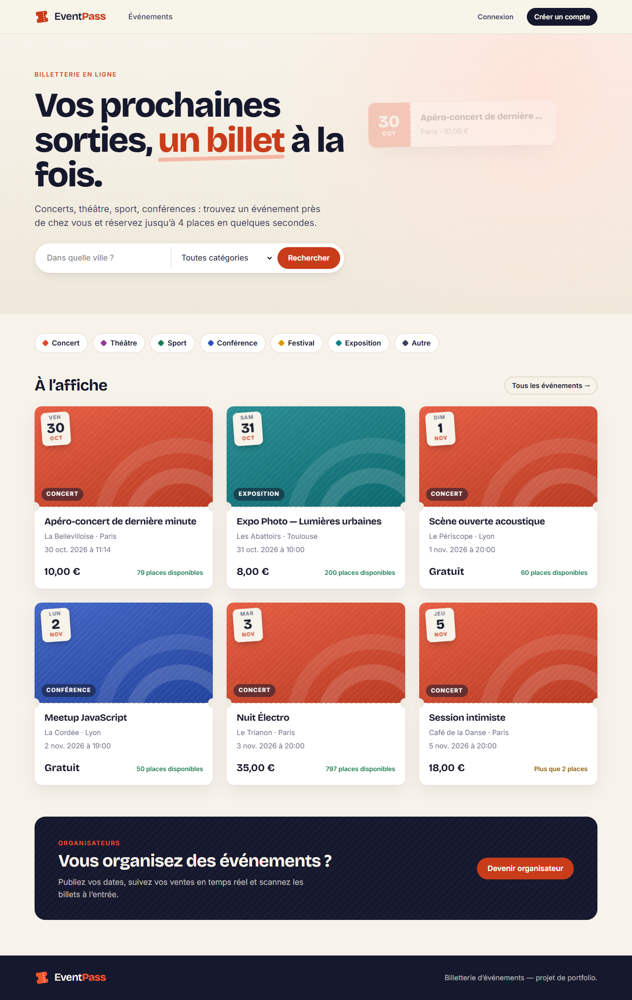
  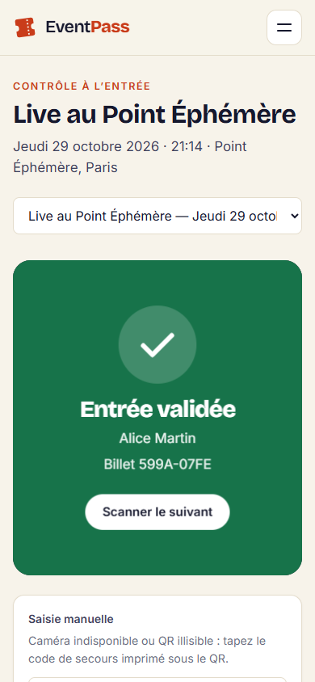
  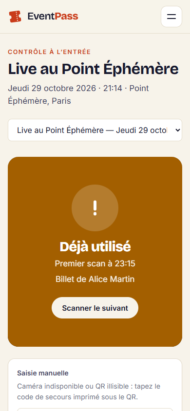
</p>

## Sommaire

- [Fonctionnalités](#fonctionnalités)
- [Lancer le projet en une commande](#lancer-le-projet-en-une-commande)
- [Comptes de démo](#comptes-de-démo)
- [Captures d'écran](#captures-décran)
- [Architecture](#architecture)
- [Stack technique](#stack-technique)
- [Comment la survente est empêchée](#comment-la-survente-est-empêchée)
- [Sécurité du QR code et du check-in](#sécurité-du-qr-code-et-du-check-in)
- [Autres choix de sécurité](#autres-choix-de-sécurité)
- [Tests et intégration continue](#tests-et-intégration-continue)
- [Développement local](#développement-local)
- [Tester le scanner sur un téléphone](#tester-le-scanner-sur-un-téléphone)
- [Structure du dépôt](#structure-du-dépôt)

## Fonctionnalités

| Rôle | Ce qu'il peut faire |
|---|---|
| **Visiteur** | Parcourir les événements avec filtres (ville, catégorie, dates, prix) et pagination, voir les places restantes |
| **Spectateur** | S'inscrire, réserver 1 à 4 billets par événement, afficher ses billets (QR code + code de secours), annuler jusqu'à 24 h avant |
| **Organisateur** | S'inscrire (compte validé par un admin), créer / modifier / annuler ses événements, suivre ventes, remplissage et entrées, **scanner les billets** (caméra ou saisie manuelle) |
| **Admin** | Valider ou refuser les organisateurs, consulter les statistiques globales (ventes, top catégories et villes) |

## Lancer le projet en une commande

Prérequis : **Docker** (avec Docker Compose).

```bash
git clone https://github.com/zakaech/EventPass.git
cd EventPass
docker compose up --build
```

Puis ouvrir **http://localhost:8080**.

Au premier démarrage, la base PostgreSQL est créée, les migrations SQL sont appliquées et les
données de démo sont insérées automatiquement. Les secrets (JWT, QR) sont générés au hasard si
vous n'en fournissez pas : c'est pratique en local, mais les sessions et les QR codes changent à
chaque redémarrage du backend.

| Variable (facultative) | Effet |
|---|---|
| `SEED_DEMO=false` | Démarrer avec une base vide |
| `JWT_SECRET`, `QR_SECRET` | Secrets fixes (au moins 32 caractères, différents) |
| `FRONTEND_PORT=8081` | Changer le port de l'interface |

`docker compose down -v` arrête tout et supprime les données.

## Comptes de démo

Mot de passe commun : **`Password123!`** — la page de connexion propose aussi une connexion en un clic.

| Rôle | Email |
|---|---|
| Admin | `admin@eventpass.dev` |
| Spectateurs | `alice@eventpass.dev`, `bob@eventpass.dev` |
| Organisateurs validés | `sonora@eventpass.dev`, `atlas@eventpass.dev` |
| Organisateur en attente | `nouveau@eventpass.dev` |

Pour essayer le check-in : Alice possède des billets pour *Live au Point Éphémère*, un événement
en cours dont le contrôle est ouvert ; Sonora en est l'organisatrice.

## Captures d'écran

| | |
|---|---|
| 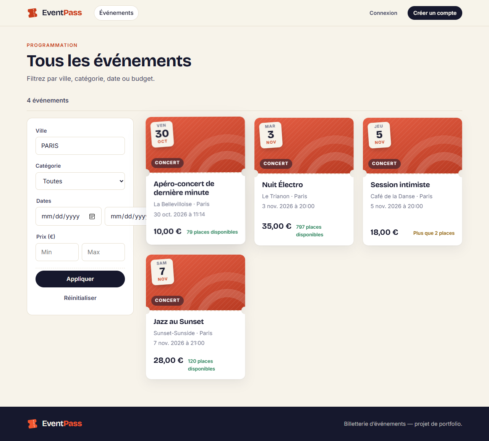 | 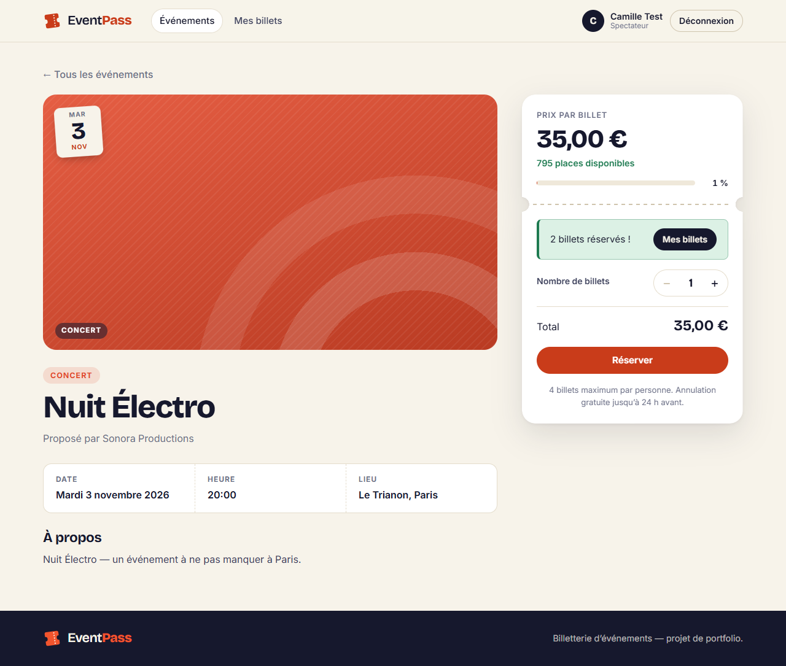 |
| Recherche (ville insensible à la casse, catégorie, prix) | Réservation avec places restantes |
| 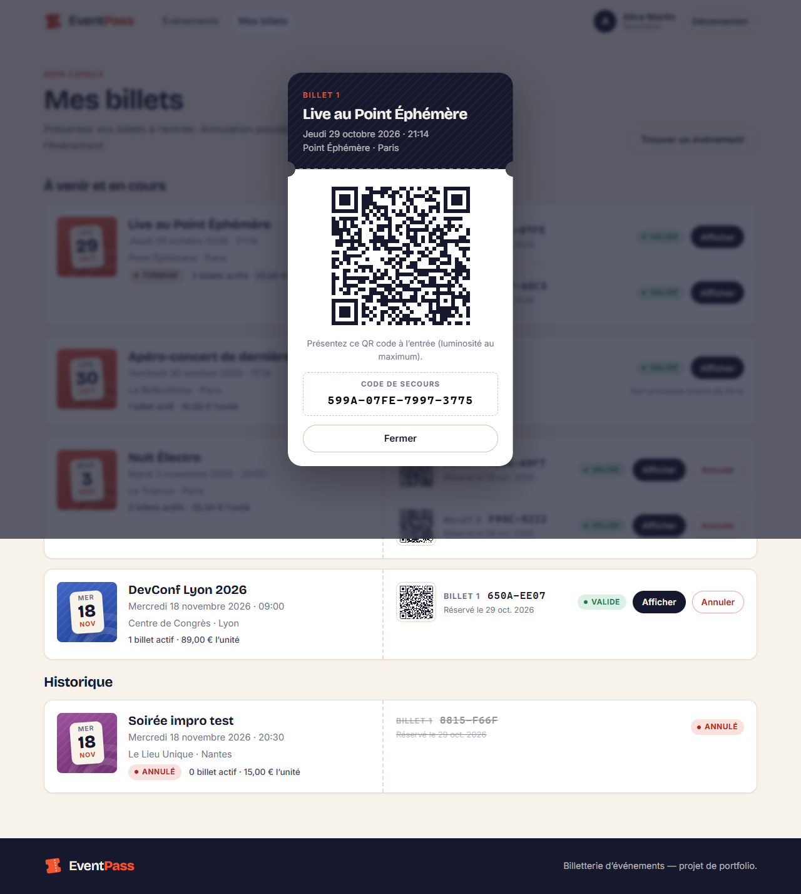 | 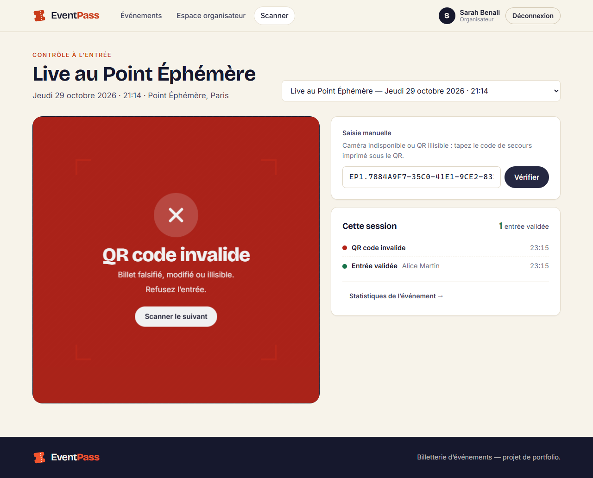 |
| Billet à présenter : QR signé et code de secours | Scanner : QR falsifié refusé |
| 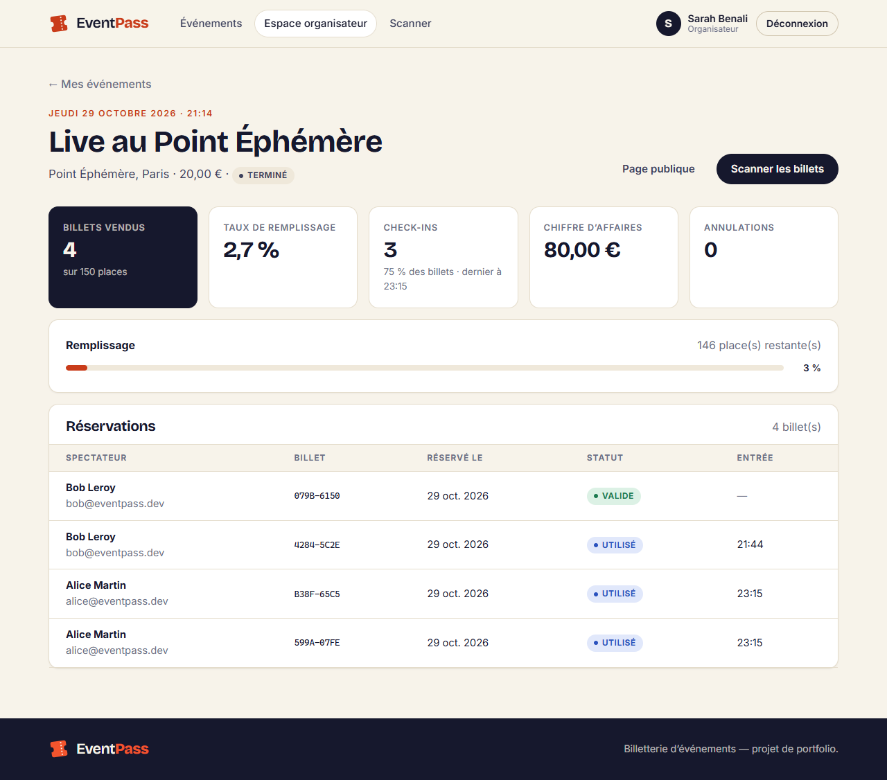 | 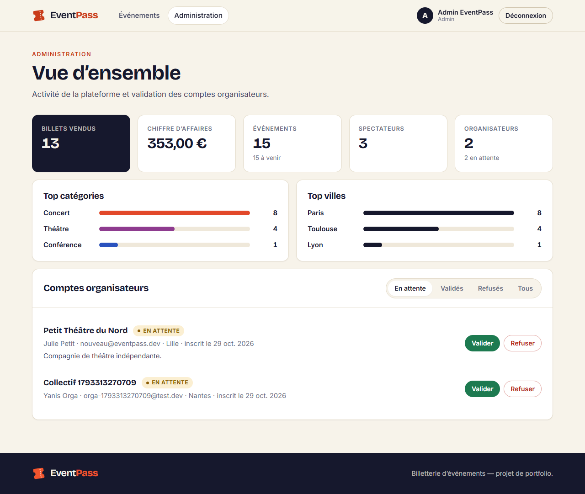 |
| Statistiques de l'organisateur : remplissage, entrées | Espace admin : validation, classements |

<details>
<summary>Versions mobiles (390 px)</summary>

<p>
  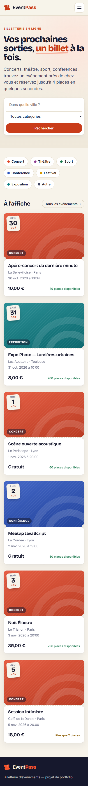
  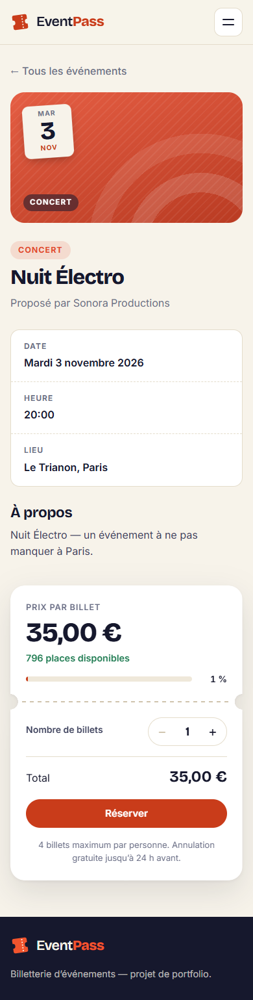
  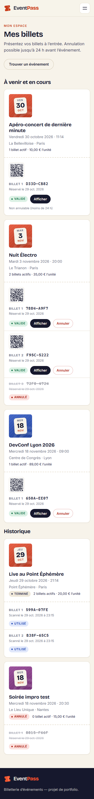
  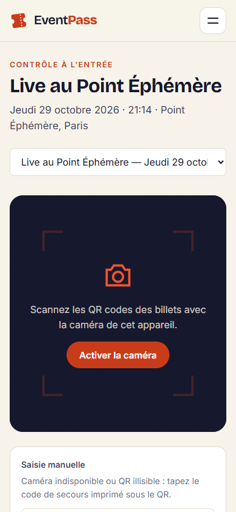
</p>
</details>

## Architecture

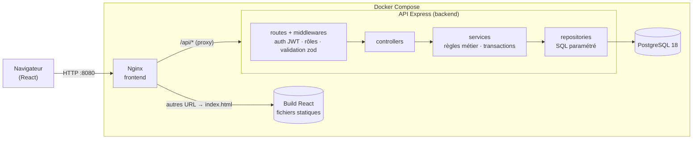

- **Une seule origine** pour le navigateur : Nginx sert l'interface et relaie `/api` vers
  l'API, sans CORS ni « contenu mixte ».
- **Backend en couches** : les routes déclarent les middlewares (authentification, rôle,
  validation) ; les contrôleurs traduisent HTTP ↔ métier ; les services portent les règles et
  les transactions ; les repositories contiennent tout le SQL. Chaque couche se teste
  séparément : les services sont testés unitairement, avec des repositories simulés.
- **Erreurs centralisées** : les services lèvent des erreurs typées (`NotFoundError`,
  `ConflictError`…), et un seul middleware les transforme en `{ error: { code, message, details } }`.

Modèle de données : `users` 1–1 `organisateurs` 1–N `events` 1–N `tickets` N–1 `users`.
Le schéma et les index sont commentés dans
[`backend/migrations`](backend/migrations/1793306191915_schema-initial.sql).

## Stack technique

| | |
|---|---|
| **Frontend** | React 19, Vite 8, React Router 8, Context API, axios (intercepteurs JWT et 401), CSS Modules, `qrcode`, `html5-qrcode` |
| **Backend** | Node.js 24, Express 5, `pg` (SQL écrit à la main, sans ORM), zod, JWT + bcrypt, helmet, express-rate-limit |
| **Base de données** | PostgreSQL 18, migrations SQL versionnées (`node-pg-migrate`) |
| **Tests** | Jest (unitaires avec `jest.mock`, intégration avec Supertest sur une vraie base), Playwright (scénario de bout en bout, caméra simulée) |
| **DevOps** | Docker (images multi-étapes, utilisateurs non-root), Docker Compose, Nginx, GitHub Actions |

## Comment la survente est empêchée

Le problème : il reste **une place**, deux personnes cliquent sur « Réserver » en même temps.
Si le serveur *lit* le nombre de places (1) puis *écrit* 0, les deux requêtes peuvent lire 1
avant que l'une n'écrive. Résultat : deux billets pour une seule place.

La solution : **vérifier et écrire en une seule instruction SQL**, dans une transaction.

```sql
UPDATE events
SET places_restantes = places_restantes - $2
WHERE id = $1 AND statut = 'PUBLIE' AND date_debut > now()
  AND places_restantes >= $2      -- la vérification fait partie de l'écriture
RETURNING *;
```

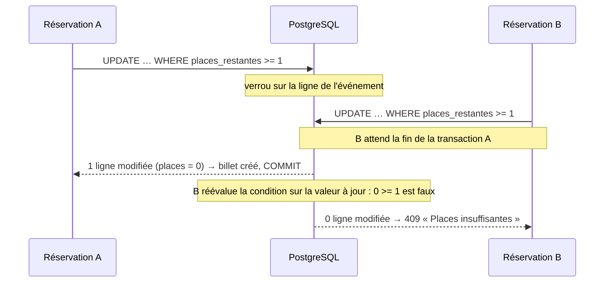

- **Le quota de 4 billets par personne** est compté *après* cet `UPDATE`, dans la même
  transaction. Le verrou posé sur l'événement fait passer les réservations une par une. Si on
  comptait avant, deux réservations simultanées de la même personne pourraient compter 0
  toutes les deux et dépasser la limite ensemble.
- **Un quota dépassé** déclenche une erreur, et le `ROLLBACK` rend aussi les places.
- **Dernier rempart** : une contrainte `CHECK (places_restantes >= 0)` en base.
- **Prouvé par des tests** : 20 réservations simultanées sur 5 places donnent exactement 5
  succès. En remplaçant volontairement l'`UPDATE` par un « lire puis écrire », le même test
  observe 20 billets vendus pour 5 places et échoue.

Alternative étudiée : `SELECT … FOR UPDATE` (lire en verrouillant, vérifier en JavaScript, puis
écrire). Elle est utilisée pour la modification d'un événement, où il faut lire le nombre de
billets vendus avant de recalculer les places.

## Sécurité du QR code et du check-in

**Ce que contient le QR** : `EP1.<identifiant du billet>.<signature>`, où la signature est un
**HMAC-SHA256** calculé avec un secret connu du seul serveur (`QR_SECRET`).

- **Pas juste un id** : un identifiant seul se devine ou se recopie (billet 41, donc 42…). Sans
  le secret, impossible de produire une signature valide. Un QR inventé ou modifié, même
  d'un caractère, est rejeté **avant toute requête en base**.
- **Un secret dédié**, distinct de celui des sessions (JWT). Une fuite de l'un ne compromet pas
  l'autre, et chacun peut être changé sans invalider l'autre (changer le secret des sessions
  ne doit pas annuler les billets déjà envoyés). Le serveur refuse de démarrer si les deux
  secrets sont identiques.
- **Comparaisons en temps constant** (`crypto.timingSafeEqual`) : le temps de réponse ne
  révèle pas combien de caractères de la signature sont justes.
- **Code de secours** (`XXXX-XXXX-XXXX-XXXX`) à taper si la caméra ne fonctionne pas : le
  début de l'identifiant suivi d'une signature courte, calculée dans un contexte distinct du
  QR.

**La signature n'empêche pas de copier un vrai billet**, c'est le check-in qui s'en charge, en
une seule instruction atomique :

```sql
UPDATE tickets t SET statut = 'UTILISE', checked_in_at = now()
FROM events e
WHERE t.code = $1 AND t.event_id = $2 AND t.statut = 'VALIDE'
  AND e.id = t.event_id AND e.organisateur_id = $3   -- l'événement de l'organisateur connecté
  AND e.statut = 'PUBLIE'                            -- pas annulé
  AND now() BETWEEN e.date_debut - interval '6 h' AND e.date_debut + interval '12 h'
```

Deux scans simultanés du même billet donnent **exactement un succès**. Le second obtient
« Déjà utilisé », avec l'heure du premier scan. Les autres refus ont chacun leur message :
billet annulé, billet d'un autre événement (sans rien révéler si l'événement appartient à un
autre organisateur), contrôle pas encore ouvert ou déjà fermé. La fenêtre de contrôle est
configurable (`CHECKIN_OPENS_HOURS_BEFORE`, `CHECKIN_WINDOW_HOURS`).

## Autres choix de sécurité

- **Mots de passe** : hachés avec bcrypt (sel aléatoire, coût configurable). À la connexion,
  la réponse est identique pour un email inconnu et un mauvais mot de passe (même message,
  même durée), pour ne pas révéler quels comptes existent.
- **JWT** : signature HS256 imposée à la vérification, durée de validité configurable. Le
  statut « organisateur validé » est relu en base à chaque requête, pas stocké dans le jeton.
- **Requêtes SQL toujours paramétrées** (`$1`, `$2`…) : les valeurs ne sont jamais concaténées
  au SQL, ce qui empêche l'injection SQL.
- **Entrées validées** avec zod (types, bornes, formats) ; les champs inconnus sont ignorés
  (impossible de s'attribuer le rôle `ADMIN` à l'inscription).
- **API** : helmet (en-têtes de sécurité), CORS limité aux origines autorisées, limitation des
  tentatives de connexion par IP (`TRUST_PROXY` pour lire la vraie IP derrière Nginx), erreurs
  500 sans détail interne.
- **Conteneurs** : utilisateurs non-root, aucun secret dans les images (`.dockerignore`), aucun
  secret dans le dépôt (CI comprise : secrets de test générés à chaque exécution).

## Tests et intégration continue

| | Quoi | Commande |
|---|---|---|
| **Unitaires** (≈ 60) | Services isolés : repositories et transaction remplacés par des `jest.mock` | `cd backend && npm run test:unit` |
| **Intégration** (≈ 70) | Requêtes HTTP réelles (Supertest) sur une vraie base PostgreSQL : parcours complet, concurrence (survente, quota, double check-in), QR falsifiés… | `npm run test:integration` |
| **Couverture** | Rapport et seuils minimaux (90 % des lignes) : en dessous, la CI échoue | `npm run test:coverage` |
| **Bout en bout** | 31 étapes dans un vrai navigateur, dont un scan par **caméra simulée** (une vidéo du QR d'un vrai billet) | voir [`e2e/README.md`](e2e/README.md) |

Le workflow [GitHub Actions](.github/workflows/ci.yml) tourne à chaque push et pull request :

1. **Backend** : lint, tests unitaires et d'intégration avec un service PostgreSQL, couverture.
2. **Frontend** : lint et build de production.
3. **Docker** : build des images, `docker compose up --wait`, vérifications de fumée.
4. **E2E** : pile Docker complète et scénario Playwright (une fois les deux premiers verts).

Un test qui échoue fait passer la pull request en rouge : cela a été vérifié sur une pull
request de démonstration, fermée ensuite.

## Développement local

Pour développer avec le rechargement à chaud (Node.js 22+ et Docker requis) :

```bash
docker compose up -d db          # PostgreSQL seul, sur localhost:5433

cd backend
cp .env.example .env             # puis remplacer JWT_SECRET et QR_SECRET
npm install
npm run db:migrate
npm run db:seed                  # vide la base et insère les données de démo
npm run dev                      # API sur http://localhost:3000/api/v1

cd frontend                      # dans un second terminal
npm install
npm run dev                      # http://localhost:5173 (Vite relaie /api vers l'API)
```

Requêtes d'exemple pour l'API : [`backend/requests/eventpass.http`](backend/requests/eventpass.http)
(extension VS Code « REST Client »).

## Tester le scanner sur un téléphone

Les navigateurs n'autorisent la caméra que sur une page sécurisée : HTTPS, ou `localhost`.

```bash
cd frontend
npm run dev:phone        # affiche une URL « Network: https://192.168.x.x:5173 »
```

1. Le téléphone doit être sur le **même réseau Wi-Fi** que l'ordinateur (autoriser Node.js dans
   le pare-feu si une fenêtre le demande).
2. Ouvrir `https://192.168.x.x:5173` sur le téléphone et accepter l'avertissement du
   certificat auto-signé.
3. Se connecter avec `sonora@eventpass.dev`, ouvrir **Scanner**, autoriser la caméra.
4. Sur l'ordinateur, se connecter avec `alice@eventpass.dev` → Mes billets → « Afficher » sur un
   billet de *Live au Point Éphémère*, et le présenter à la caméra.

L'API n'a pas besoin d'être exposée : Vite relaie `/api` vers `localhost:3000` (une page HTTPS
ne peut pas appeler une API en HTTP). Autre option : un tunnel HTTPS (`cloudflared`, ngrok).

## Structure du dépôt

```
EventPass/
├── backend/              API Express
│   ├── src/              routes · controllers · services · repositories · middlewares · validators · utils · config
│   ├── migrations/       schéma SQL versionné
│   ├── scripts/          migrations, données de démo, point d'entrée Docker
│   ├── tests/            unit/ (jest.mock) · integration/ (Supertest + PostgreSQL)
│   └── Dockerfile
├── frontend/             React (Vite)
│   ├── src/              pages · components · services · context · hooks · utils
│   ├── nginx.conf        SPA + proxy /api
│   └── Dockerfile
├── e2e/                  scénario Playwright + caméra simulée
├── docs/screenshots/     captures d'écran
├── docker-compose.yml
└── .github/workflows/    CI
```
